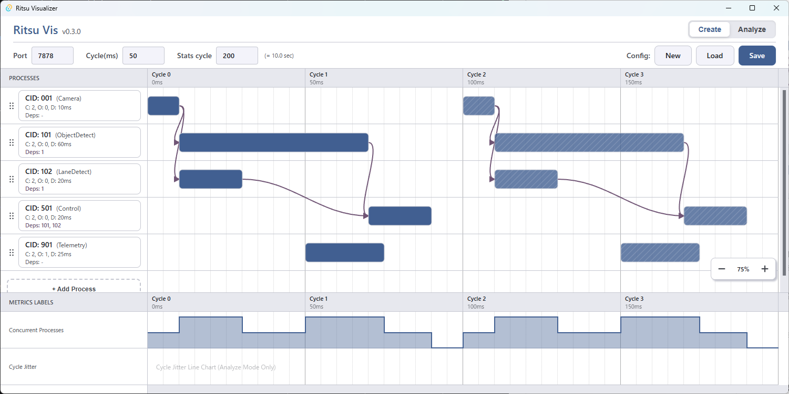
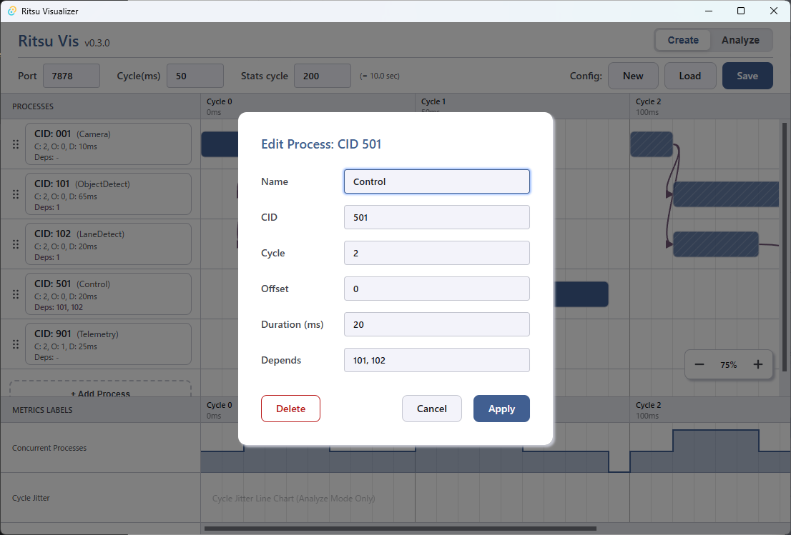
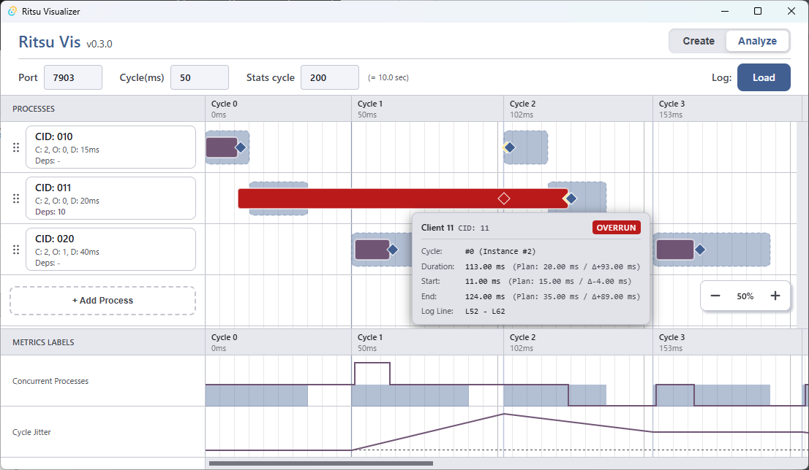
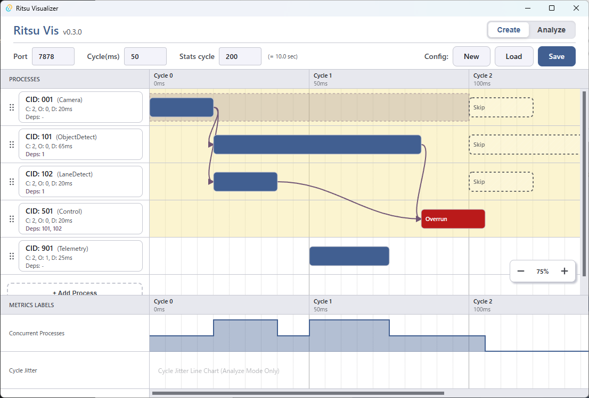
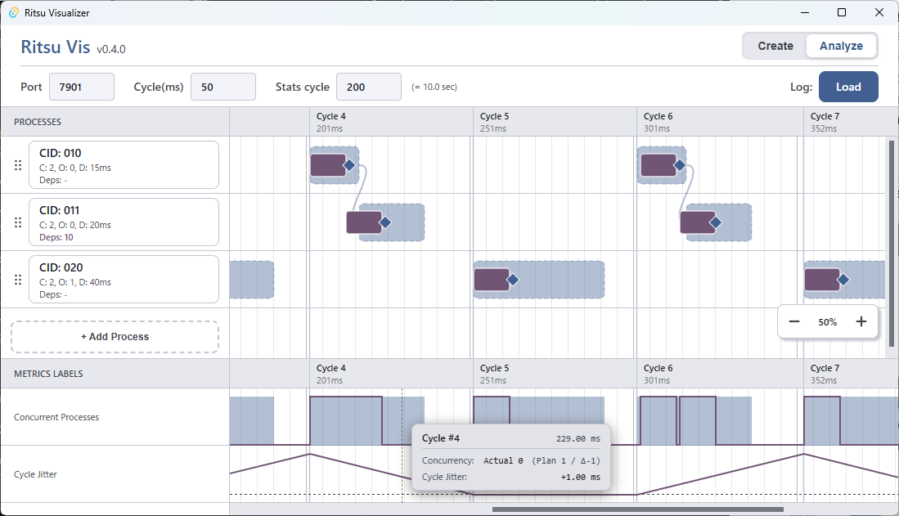
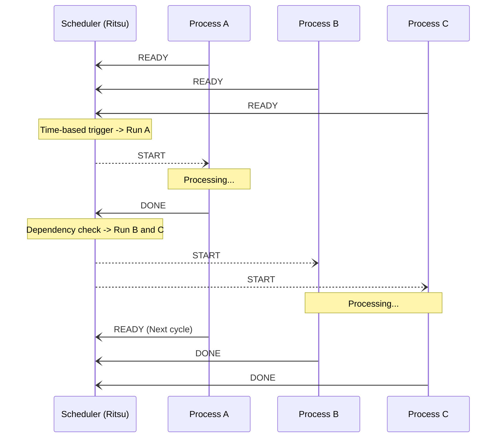

# Ritsu: A Deterministic Process Scheduler

A lightweight, deterministic process scheduler that manages user processes considering periodic cycles and dependencies.



## Features

- **Periodic Execution**: Predictable execution based on pre-defined timing and cycles.
- **Dependency Management**: Flexible scheduling based on process dependencies (sequential and parallel).
  - Example: Image processing pipelines using camera frames.
- **Multi-Language Support**: A simple messaging protocol supporting multiple programming languages.
  - Modular transport support (UDP-based by default).
  - This repository includes sample clients for **Rust**, **Python**, and **C/C++**.
- **Simulation & Visualization**: Advanced tools for system planning and scheduling analysis.

**Visualizer Highlights:**
| Create Mode | Analyze Mode |
| :---: | :---: |
| <br />Configure process periods, execution times, and dependencies. | <br />Overlay actual execution logs onto scheduled plans, inspecting timing deltas and exact log lines. |
| <br />Interactive drag-and-drop editing immediately highlights deadline overruns and cascading delays. | <br />Track planned vs actual concurrent processes to identify system load peaks and bottlenecks. |

## Quickstart

Experience Ritsu's multi-language coordination and deterministic DAG execution with our reference demo.

### Robot Pipeline Demo

Simulates an Autonomous Mobile Robot (AMR) obstacle-avoidance pipeline where five heterogeneous processes execute cooperatively at 5 Hz across C, Python, and Rust. This demo is fully self-contained using standard libraries with zero external dependencies.

```text
[Sensor (C)] ──┬──> [AI-Vision (Python)] ──┬──> [Planner (Rust)] ──> [Motor (C)]
               └──> [Odometry (C)]       ──┘
```

1. **Run the demo** (builds and launches all 5 nodes in dedicated console windows automatically):
   - **Windows (PowerShell):**
     ```powershell
     cd demo/robot-pipeline
     .\run_demo.ps1
     ```
   - **Linux / macOS (Bash):**
     ```bash
     cd demo/robot-pipeline
     ./run_demo.sh
     ```

2. **Inspect with the visualizer**:  
   Launch `rt-vis` and open `demo/robot-pipeline/logs/rt-server.log` in **Analyze** mode to inspect scheduled vs. actual timelines and safety slack margins:
   ```bash
   cargo run -p rt-vis
   ```

For detailed architecture, prerequisites, and scenario specifications, see the [Robot Pipeline Demo Guide](demo/robot-pipeline/README.md).

## Process Scheduling

This section describes how Ritsu schedules your processes using a sequence diagram.
For more details, please refer to the [detailed documentation](./docs/README.md).

### Example Scenario: A -> (B, C)

- Process A starts periodically.
- Processes B and C start simultaneously once A completes.



## Repository Structure

- **[rt-config-rs](./rt-config-rs)**: Common configuration structures and validation logic shared between the scheduler and visualization tools.
- **[rt-core-rs](./rt-core-rs)**: The core scheduling logic. Manages process states and dependency resolutions.
- **[rt-server-rs](./rt-server-rs)**: The Ritsu scheduler server. Responsible for client management, timing control, and coordinating execution with the core scheduler.
- **[rt-message-rs](./rt-message-rs)**: Common message types and serialization protocol used for server-client communication.
- **[rt-client-rs](./rt-client-rs)**: Client library for Rust.
- **[rt-client-py](./rt-client-py)**: Client library for Python.
- **[rt-client-c](./rt-client-c)**: Client library for C/C++.
- **[rt-vis-rs](./rt-vis-rs)**: Tauri-based visualizer application for process scheduling simulation and configuration editing.

## Documentation

Detailed specifications and guides can be found in the [docs](./docs/README.md) directory.

## License

This project is licensed under the Apache License, Version 2.0. See the [LICENSE](LICENSE) file for details.
