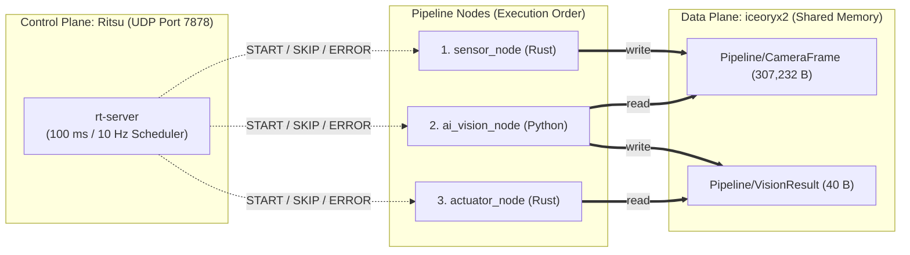

# Ritsu Pipeline Demo: External Data Plane with iceoryx2

This directory provides a reference demonstration of pairing **Ritsu** (Control Plane) with an external Data Plane—**[Eclipse iceoryx2](https://iceoryx.io/)** ([GitHub](https://github.com/eclipse-iceoryx/iceoryx2))—to achieve deterministic, multi-language pipeline execution with inter-process data exchange across **Rust** and **Python**.

The demo runs a 3-node perception-to-actuation pipeline at **10 Hz (100 ms cycle)** over **33 cycles (0-indexed `Cyc 00`–`Cyc 32`, ~3.3 seconds)**, demonstrating deterministic scheduling alongside shared-memory payload transfer, autonomous fallback on invalid sensor data, recovery from a single-cycle AI inference spike, and multi-stage fail-safe emergency stop (`E-STOP`) with client-initiated shutdown.

---

## 1. Overview

- **Control Plane vs. Data Plane Separation**: Ritsu strictly coordinates execution timing, DAG dependency ordering, and fault arbitration over UDP without touching payload bytes, while `iceoryx2` transfers `#[repr(C)]` / `ctypes.Structure` payloads through lock-free shared memory without daemon processes or serialization.
- **Cross-Language Zero-Copy IPC**: Transfers 307,232-byte camera frames (`Rust` -> `Python`) and 40-byte vision results (`Python` -> `Rust`) while keeping shared-memory borrow lifetimes scoped strictly to processing.
- **Deterministic Degradation & Fail-Safe**: Demonstrates early fallback completion on invalid frames, upstream/downstream `SKIP` protection during an AI spike, autonomous recovery, and `E-STOP` full-system shutdown on consecutive `SKIP`s.
- **Isolated Environment & Visualizer Integration**: Uses a standalone Cargo workspace and a demo-local Python `.venv`, and records detailed execution traces in `logs/rt-server.log` for inspection in `rt-vis`.

---

## 2. Prerequisites

Ensure the following toolchains are installed on your system before running the demo:

### Windows
- **Rust toolchain** (`cargo`, `rustc`): Version 1.85 or later (required for Rust edition `2024`).
- **Python 3**: Version 3.12 or later (accessible via `py` or `python`, with the `venv` module).
- **Node.js & npm**: Version 18 or later (required only when building `rt-vis` from source; optional if using the pre-built Windows binary).

### Linux / macOS
- **Rust toolchain** (`cargo`, `rustc`): Version 1.85 or later (required for Rust edition `2024`).
- **Python 3**: Version 3.12 or later (`python3`, with `python3-venv` installed on Debian/Ubuntu).
- **Node.js & npm**: Version 18 or later (required only for `rt-vis`).

> [!NOTE]
> `iceoryx2==0.10.0` for Python does **not** need to be installed globally. The launch scripts automatically manage an isolated virtual environment at `demo/iceoryx2-pipeline/.venv`.

---

## 3. Pipeline Architecture & Scenario

### 3.1. Architecture, Data Flow & QoS Policy



Both `iceoryx2` topics share a "latest-value-only, non-destructive borrow" QoS policy configured on both Publisher and Subscriber (`open_or_create()`):

| Service Name (Topic) | Publisher | Subscriber | Payload Type | Exact Size |
| :--- | :--- | :--- | :--- | :---: |
| `Pipeline/CameraFrame` | `sensor_node` (Rust) | `ai_vision_node` (Python) | `SensorResult` (`PayloadHeader` + 640x480 grayscale) | 307,232 bytes |
| `Pipeline/VisionResult` | `ai_vision_node` (Python) | `actuator_node` (Rust) | `VisionResult` (`PayloadHeader` + detection fields) | 40 bytes |

Shared QoS settings:
- `subscriber_max_buffer_size = 1` & `enable_safe_overflow = true`: Keeps at most 1 unread sample in the subscriber queue, safely overwriting older unread samples when a newer sample is published.
- `subscriber_max_borrowed_samples = 1`: Caps concurrent borrows per subscriber at 1. Consumers drain `receive()` while releasing the prior borrow before the next read, hold the newest `Sample` through processing, and verify `header.cycle >= running_cycle` (0-indexed) before acting on it.
- `history_size = 0`: Disables late-joining history because Ritsu synchronizes all clients via `JOIN` at startup.

### 3.2. Node & Scheduler Specifications

Scheduler parameters are defined in [`config.toml`](config.toml).

#### Server Configuration (`[server_config]`)

| Concept | TOML Key | Value | Purpose |
| :--- | :--- | :---: | :--- |
| Server UDP Port | `port` | `7878` | Control Plane UDP signaling port |
| Cycle Period | `cycle_time_ms` | `100` | Fixed 100 ms (10 Hz) scheduling boundary |
| Stats Interval | `stats_interval_cycle` | `10` | Console summary frequency (every 10 cycles) |
| Console Log Level | `log_level` | `"info"` | Console output verbosity |
| Log Directory | `log_file_dir` | `"./logs"` | Output directory for `rt-server.log` |
| File Log Level | `log_file_level` | `"debug"` | Detailed trace level required by `rt-vis` |

#### Client Nodes (`[[client_configs]]`)

All clients share `start_cycle = 0`, `interval = 1`, and `offset = 0`.

| `client_id` | `display_name` | `depends` | `expected_duration_ms` | Node (Language) | Role & Zero-Copy Implementation |
| :---: | :--- | :---: | :---: | :--- | :--- |
| **10** | `"Sensor (Rust)"` | `[]` | `10` | `sensor_node` (Rust) | Generates 640x480 frames in a heap buffer, writes directly into `loan_uninit()` shared memory (`assume_init()`), and sends `SensorResult`. |
| **20** | `"AI-Vision (Py)"` | `[10]` | `40` | `ai_vision_node` (Python) | Borrows `Pipeline/CameraFrame` in-place via `ctypes.Structure`, runs simulated inference (or 5 ms fallback), and sends `VisionResult` via `loan_uninit()` / `write_payload()`. |
| **30** | `"Actuator (Rust)"` | `[20]` | `15` | `actuator_node` (Rust) | Borrows `Pipeline/VisionResult`, checks freshness/`status`, and enforces skip fail-safe (`CRUISE` -> `Braking 50%` -> `E-STOP 0%`). |

### 3.3. 33-Cycle Scenario Sequence (`Cyc 00`–`Cyc 32`)

All payload headers, `rt-server` logs, and node console logs (`[Cyc 00]`–`[Cyc 32]`) consistently use **0-indexed `running_cycle` (`0..32`)**.

| Cycle (`running_cycle`) | Phase | Events & Behavior | Ritsu Control Plane & Fail-Safe Result |
| :---: | :--- | :--- | :--- |
| **0–9** | **Phase 1: Normal Cruising** | `sensor_node` (~10 ms) -> `ai_vision_node` (~40 ms) -> `actuator_node` (~15 ms). | Deterministic dispatch with ~35 ms end-of-cycle slack; verifies microsecond-level `ipc_read_us`. |
| **10** | **Phase 2: Invalid Frame & Early Fallback** | `sensor_node` sets `header.status = 1` (`STATUS_INVALID`). `ai_vision_node` detects `status != 0`, switches to lightweight fallback (**~5 ms**), and propagates `status = 1`. | `actuator_node` starts **~35 ms earlier** than nominal, logs `CRUISE(FALLBACK) speed=100% (reason=status=1, src_cyc=10)`, and finishes with increased cycle slack. |
| **11–19** | **Phase 2: Recovery** | `sensor_node` restores `status = 0` (`STATUS_VALID`); `ai_vision_node` returns to ~40 ms inference. | Nominal cruising resumes immediately with zero missed cycles. |
| **20** | **Phase 3: AI Spike** | `ai_vision_node` spikes to **~110 ms**, crossing the 100 ms cycle boundary. | At Cyc 21 boundary, `ai_vision_node` is still running (`Overrun`). |
| **21** | **Phase 3: Single SKIP** | `rt-server` issues `SKIP` to `sensor_node` and `actuator_node`. `ai_vision_node` finishes ~10 ms into Cyc 21 (`DONE=OK`, then receives `LATE` on next `READY`). | `actuator_node` increments `consecutive_skips = 1` and engages **Braking mode (speed 50%)**. |
| **22–29** | **Phase 3: Autonomous Recovery** | `ai_vision_node` runs normally (~40 ms) and publishes `cycle = 22` (`safe_overflow` overwrites stale `cycle = 20`). | `actuator_node` verifies `header.cycle == 22`, resets `consecutive_skips = 0`, and resumes **100% cruising**. |
| **30** | **Phase 4: Severe Freeze** | `ai_vision_node` freezes for **~300 ms** (spanning multiple cycles). | `ai_vision_node` enters `Overrun`. |
| **31** | **Phase 4: 1st SKIP** | `ai_vision_node` remains frozen. | `rt-server` sends `SKIP`; `actuator_node` engages **Braking mode (`consecutive_skips = 1`)**. |
| **32** | **Phase 4: 2nd SKIP & E-STOP** | `ai_vision_node` remains frozen. | `rt-server` sends 2nd consecutive `SKIP`; `actuator_node` triggers **E-STOP (speed 0%)** and calls `client.exit()`, causing `rt-server` to broadcast `ERROR` (`ClientExit`) so all nodes shut down cleanly. |

---

## 4. How to Run

This demo is isolated from both your global Python environment and the root Cargo workspace:
- **Rust Isolation**: `demo/iceoryx2-pipeline/Cargo.toml` defines a standalone `[workspace]` (`shared_types`, `sensor_node`, `actuator_node`) with build artifacts placed under `demo/iceoryx2-pipeline/target/`.
- **Python Isolation**: The launch scripts create `demo/iceoryx2-pipeline/.venv` and install `iceoryx2==0.10.0` solely inside it (skipping `pip install` on subsequent runs when already present).

### Windows (PowerShell)

```powershell
cd demo/iceoryx2-pipeline
.\run_demo.ps1
```

> [!TIP]
> If script execution is restricted by PowerShell's execution policy, run the script with a temporary process-level bypass:
> ```powershell
> powershell -ExecutionPolicy Bypass -File .\run_demo.ps1
> ```

### Linux / macOS (Bash)

```bash
cd demo/iceoryx2-pipeline
./run_demo.sh
```

### Execution Lifecycle

1. **Build & Pre-Provision**: Builds `rt-server` (release), builds the demo Rust workspace (release), and ensures `demo/iceoryx2-pipeline/.venv` has `iceoryx2==0.10.0` **before** launching `rt-server` so setup never consumes `startup_wait_sec`.
2. **Dedicated Window Launch**: Opens separate, titled console windows for `rt-server`, `sensor_node` (CID 10), `ai_vision_node` (CID 20), and `actuator_node` (CID 30).
3. **Pause on Completion**: After E-STOP shutdown in Cycle 32, each client node displays `[Process completed] Press Enter key to close...` so you can inspect the timing logs before closing the windows.

---

## 5. Analyzing Results

### 5.1. Understanding Console Timing Metrics

Each node separates Data Plane IPC overhead, combined Control + Data Plane latency, and total task duration in its console output:

| Metric | Measurement Span & Clock | Logged By | What It Shows |
| :--- | :--- | :--- | :--- |
| **`ipc_write_us`** | `loan_uninit()` -> payload write -> `send()` (monotonic: `Instant` / `perf_counter_ns`) | `sensor_node`, `ai_vision_node` | Pure Data Plane allocation and write cost (excludes simulated work sleep). |
| **`ipc_read_us`** | `receive()` drain loop -> payload dereference (monotonic: `Instant` / `perf_counter_ns`) | `ai_vision_node`, `actuator_node` | Pure Data Plane zero-copy receive cost (microsecond-range even for 307 KB frames). |
| **`e2e_us`** | Sender `header.timestamp_us` (before `send()`) -> Receiver `receive()` (wall clock: `SystemTime` / `time.time_ns()`) | `ai_vision_node`, `actuator_node` | Inter-stage latency including `iceoryx2` transfer and Ritsu UDP `DONE` -> `START` arbitration. |
| **`proc_ms`** | `START` received -> before `notify_done()` (includes simulated work sleep) | All nodes | Total task duration matching the `rt-vis` Gantt chart bar width. |

### 5.2. Visualizing with `rt-vis`

Execution events and cycle statistics are recorded in `demo/iceoryx2-pipeline/logs/rt-server.log`.

#### Steps to Inspect
1. Launch `rt-vis`:
   - **Pre-built binary (Windows):** Download the latest `rt-vis` archive from [GitHub Releases](https://github.com/nao-kawano/ritsu-scheduler/releases), extract it, and run `rt-vis.exe`.
   - **From source (Windows / Linux / macOS):** Run from the repository root:
     ```bash
     # Install dependencies (first time only)
     npm --prefix rt-vis-rs install

     # Launch the visualizer
     npm --prefix rt-vis-rs run tauri dev
     ```
2. Navigate to **Analyze** mode in the top navigation bar.
3. Open `demo/iceoryx2-pipeline/logs/rt-server.log`.

#### Key Observations on the Gantt Chart
- **Phase 1 (`Cyc 00`–`09`)**: Tight deterministic chaining (`10 -> 20 -> 30`) with actual durations (`~10 ms`, `~40 ms`, `~15 ms`) matching `expected_duration_ms` and ~35 ms end-of-cycle slack.
- **Phase 2 (`Cyc 10`)**: `ai_vision_node` shrinks from 40 ms to ~5 ms on `STATUS_INVALID` fallback, dispatching `actuator_node` ~35 ms earlier and visibly expanding end-of-cycle slack.
- **Phase 3 (`Cyc 20`–`22`)**: `ai_vision_node` overruns the 100 ms boundary at `Cyc 20`, `rt-server` issues `SKIP` to `sensor_node` and `actuator_node` at `Cyc 21`, and deterministic alignment returns at `Cyc 22`.
- **Phase 4 (`Cyc 30`–`32`)**: The 300 ms freeze triggers consecutive `SKIP`s at `Cyc 31` and `Cyc 32`, followed immediately by client-initiated shutdown from `actuator_node` (CID 30).
