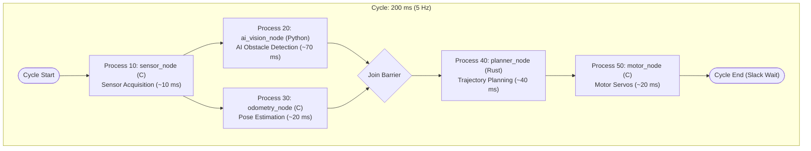

# Robot Pipeline Demo

This directory provides a reference demonstration showcasing key features of **Ritsu**: **multi-language coordination (C / Python / Rust)** and **deterministic DAG (Fork-Join) execution**.

The demonstration simulates an Autonomous Mobile Robot (AMR) obstacle-avoidance pipeline where five heterogeneous processes execute cooperatively in real time without external messaging middleware.

---

## 1. Overview

- **Multi-Language Orchestration**: Coordinates processes implemented in C, Python, and Rust under a unified deterministic schedule.
- **Deterministic DAG (Fork-Join)**: Demonstrates parallel branching (Fork) and barrier synchronization (Join) within a fixed 200 ms (5 Hz) cycle.
- **Zero Heavy Dependencies**: Built entirely using each language's standard libraries and minimal platform APIs (no OpenCV, ROS 2, or external IPC frameworks required).
- **Visualizer Integration**: Execution logs can be imported directly into `rt-vis` to inspect scheduling precision, bottleneck durations, and safety slack margins.

---

## 2. Prerequisites

Ensure the following toolchains are installed on your system before running the demo:

### Windows
- **Rust toolchain** (`cargo`, `rustc`): Version 1.85 or later.
- **CMake**: Version 3.14 or later.
- **C/C++ Build Tools**: Visual Studio 2019/2022 with the "Desktop development with C++" workload (MSVC).
- **Python 3**: Python 3.8 or later (accessible via `python` or `py`).

### Linux / macOS
- **Rust toolchain** (`cargo`, `rustc`): Version 1.85 or later.
- **CMake**: Version 3.14 or later.
- **C/C++ Compiler**: GCC (>= 9) or Clang.
- **Python 3**: Python 3.8 or later (`python3`).

---

## 3. Pipeline Architecture & Scenario

### 3.1. Data Flow & Dependency Graph



### 3.2. Node Specifications

| Client ID | Node Name | Language | Role | Duration (Simulated) | Domain Status / Log Summary |
| :---: | :--- | :---: | :--- | :---: | :--- |
| **10** | `sensor_node` | **C** | Raw sensor acquisition (LiDAR / Camera) | 8–12 ms | Point cloud scans and camera frames |
| **20** | `ai_vision_node` | **Python** | Dynamic obstacle detection | 55–85 ms | Pedestrian detection and tracking |
| **30** | `odometry_node` | **C** | Robot pose estimation | 18–23 ms | Position and orientation updates ($x, y, \text{yaw}$) |
| **40** | `planner_node` | **Rust** | Trajectory and velocity planning | 35–45 ms | Path steering commands ($v, \omega$) |
| **50** | `motor_node` | **C** | Wheel actuator drive commands | 18–22 ms | 4-wheel independent servo speeds (rpm) |

### 3.3. 25-Cycle Scenario Sequence

The pipeline executes for **25 cycles (approx. 5 seconds)** simulating a dynamic pedestrian avoidance maneuver:

- **Phase 1: Cruising (Cycles 1–7 / 0.0–1.4 s)**  
  Clear path ahead. Robot cruises straight at constant velocity ($v = 0.50\,\text{m/s}$).
- **Phase 2: Avoidance (Cycles 8–14 / 1.4–2.8 s)**  
  `ai_vision_node` detects a pedestrian ahead. `planner_node` generates a left-swerving trajectory.
- **Phase 3: Passing & Return (Cycles 15–20 / 2.8–4.0 s)**  
  The pedestrian is passed on the right. The planner steers the robot back toward the baseline.
- **Phase 4: Cruising Resumed (Cycles 21–25 / 4.0–5.0 s)**  
  Path cleared. Normal straight cruising resumes.

---

## 4. How to Run

### Windows (PowerShell)

```powershell
cd demo/robot-pipeline
.\run_demo.ps1
```

> [!TIP]
> If script execution is restricted by PowerShell's execution policy, run the script with a temporary process-level bypass:
> ```powershell
> powershell -ExecutionPolicy Bypass -File .\run_demo.ps1
> ```

### Linux / macOS (Bash)

```bash
cd demo/robot-pipeline
./run_demo.sh
```

### Execution Lifecycle
1. **Automatic Build**: The script automatically checks and builds `rt-server`, the C mock nodes (`sensor_node`, `odometry_node`, `motor_node`), and the Rust mock node (`planner_node`).
2. **Dedicated Window Launch**: The server and all five client nodes launch in separate, titled console windows.
3. **Synchronized Execution**: Nodes exchange `READY` / `START` / `DONE` protocol messages with `rt-server`, running rhythmically at 5 Hz.
4. **Pause on Completion**: After 25 cycles, each node displays `[Process completed] Press Enter key to close...`, allowing you to inspect the console outputs at your own pace.

---

## 5. Analyzing with `rt-vis`

Execution events and timing statistics are recorded in `demo/robot-pipeline/logs/rt-server.log`. You can inspect the scheduled vs. actual timeline using Ritsu's visualizer.

### Steps to Inspect
1. Start the visualizer:
   ```bash
   cargo run -p rt-vis
   ```
2. Navigate to the **Analyze** mode in the top navigation bar.
3. Open `demo/robot-pipeline/logs/rt-server.log`.

### Key Observations on the Gantt Chart
- **Fork Concurrency**: Observe `ai_vision_node` (Python) and `odometry_node` (C) starting concurrently right after `sensor_node` completes.
- **Slack & Margin**: Notice that `odometry_node` finishes early (~20 ms) and leaves approximately 45–55 ms of safety slack before `planner_node` starts.
- **Deterministic Join**: Verify that `planner_node` (Rust) waits until **both** `ai_vision_node` and `odometry_node` complete before being dispatched.
