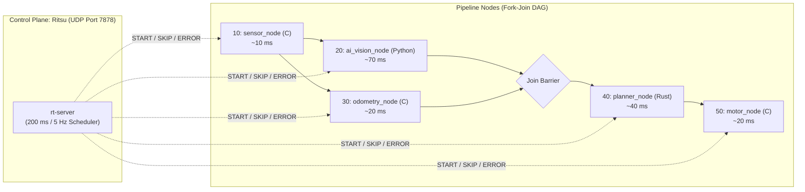

# Ritsu Pipeline Demo: Multi-Language DAG (Fork-Join)

This directory provides a reference demonstration of using **Ritsu** (Control Plane) to achieve deterministic, multi-language pipeline orchestration across **C**, **Python**, and **Rust** with a **Fork-Join DAG**.

The demo simulates an Autonomous Mobile Robot (AMR) obstacle-avoidance pipeline at **5 Hz (200 ms cycle)** over **25 cycles (0-indexed `Cyc 00`–`Cyc 24`, ~5.0 seconds)** without external messaging middleware, demonstrating deterministic periodic dispatch, parallel branching (Fork), barrier synchronization (Join), and tail-node-initiated coordinated shutdown.

---

## 1. Overview

- **Multi-Language Orchestration**: Coordinates five clients implemented in **C** (`sensor_node`, `odometry_node`, `motor_node`), **Python** (`ai_vision_node`), and **Rust** (`planner_node`) under a unified deterministic schedule over UDP.
- **Deterministic DAG (Fork-Join)**: Demonstrates parallel branching after `sensor_node` (`ai_vision_node` and `odometry_node`) and deterministic barrier synchronization (`Join`) before `planner_node` within each 200 ms (5 Hz) cycle.
- **Zero External Dependencies**: Built entirely using each language's standard libraries and minimal platform APIs (no OpenCV, ROS 2, or external IPC frameworks required).
- **Visualizer Integration**: Records detailed execution traces in `logs/rt-server.log` for direct inspection in `rt-vis` to analyze scheduling precision, bottleneck durations, and safety slack margins.

---

## 2. Prerequisites

Ensure the following toolchains are installed on your system before running the demo:

### Windows
- **Rust toolchain** (`cargo`, `rustc`): Version 1.85 or later (required for Rust edition `2024`).
- **CMake**: Version 3.14 or later.
- **C/C++ Build Tools**: Visual Studio 2022 with the "Desktop development with C++" workload (MSVC).
- **Python 3**: Version 3.12 or later (accessible via `py` or `python`).
- **Node.js & npm**: Version 18 or later (required only when building `rt-vis` from source; optional if using the pre-built Windows binary).

### Linux / macOS
- **Rust toolchain** (`cargo`, `rustc`): Version 1.85 or later (required for Rust edition `2024`).
- **CMake**: Version 3.14 or later.
- **C/C++ Compiler**: GCC (>= 9) or Clang (C11 support).
- **Python 3**: Version 3.12 or later (`python3` or `python`).
- **Node.js & npm**: Version 18 or later (required for `rt-vis`).

---

## 3. Pipeline Architecture & Scenario

### 3.1. Architecture & Dependency Graph



### 3.2. Node & Scheduler Specifications

Scheduler parameters are defined in [`config.toml`](config.toml).

#### Server Configuration (`[server_config]`)

| Concept | TOML Key | Value | Purpose |
| :--- | :--- | :---: | :--- |
| Server UDP Port | `port` | `7878` | Control Plane UDP signaling port |
| Cycle Period | `cycle_time_ms` | `200` | Fixed 200 ms (5 Hz) scheduling boundary |
| Stats Interval | `stats_interval_cycle` | `10` | Console summary frequency (every 10 cycles) |
| Console Log Level | `log_level` | `"info"` | Console output verbosity |
| Log Directory | `log_file_dir` | `"./logs"` | Output directory for `rt-server.log` |
| File Log Level | `log_file_level` | `"debug"` | Detailed trace level required by `rt-vis` |

#### Client Nodes (`[[client_configs]]`)

All clients share `start_cycle = 0`, `interval = 1`, and `offset = 0`.

| `client_id` | `display_name` | `depends` | `expected_duration_ms` | Node (Language) | Simulated Duration & Role |
| :---: | :--- | :---: | :---: | :--- | :--- |
| **10** | `"Sensor (C)"` | `[]` | `10` | `sensor_node` (C) | **8–12 ms**: Simulates LiDAR point cloud scan (360 pts) and camera frame capture. |
| **20** | `"AI-Vision (Py)"` | `[10]` | `70` | `ai_vision_node` (Python) | **55–85 ms**: Parallel fork after `sensor_node`; simulates dynamic pedestrian detection and ROI clearance classification. |
| **30** | `"Odometry (C)"` | `[10]` | `20` | `odometry_node` (C) | **18–23 ms**: Parallel fork after `sensor_node`; integrates wheel encoders and IMU to update robot pose ($x, y, \text{yaw}$). |
| **40** | `"Planner (Rust)"` | `[20, 30]` | `40` | `planner_node` (Rust) | **35–45 ms**: Join barrier after `ai_vision_node` and `odometry_node`; computes linear and angular velocity commands ($v, \omega$). |
| **50** | `"Motor (C)"` | `[40]` | `20` | `motor_node` (C) | **18–22 ms**: Tail node after `planner_node`; outputs 4-wheel servo speeds (rpm) and initiates shutdown after `Cyc 24`. |

### 3.3. 25-Cycle Scenario Sequence (`Cyc 00`–`Cyc 24`)

All `rt-server` logs and node console outputs (`[Cyc 00]`–`[Cyc 24]`) consistently use **0-indexed `running_cycle` (`0..24`)**.

| Cycle (`running_cycle`) | Phase | Simulated Scene & Node Behavior | Ritsu Control Plane & Pipeline Outcome |
| :---: | :--- | :--- | :--- |
| **0–6** (0.0–1.4 s) | **Phase 1: Cruising** | Clear path ahead. `odometry_node` advances straight (`x = 0.10..0.70m`); `planner_node` commands `v=0.50m/s, w=0.00rad/s`. | Deterministic 5 Hz cruising; `motor_node` drives all four wheels at `300rpm`. |
| **7–13** (1.4–2.8 s) | **Phase 2: Avoidance** | `ai_vision_node` detects a pedestrian ahead (`x=2.1m, y=0.1m`); `odometry_node` tracks the left swerve (`x = 0.80..1.30m`). | `planner_node` joins both branches and commands `v=0.35m/s, w=+0.25rad/s`; `motor_node` applies differential steering (`240rpm` / `340rpm`). |
| **14–19** (2.8–4.0 s) | **Phase 3: Passing & Return** | `ai_vision_node` tracks the passing pedestrian (`x=1.1m, y=-0.8m`); `odometry_node` steers back (`x = 1.40..1.90m`). | `planner_node` commands `v=0.40m/s, w=-0.15rad/s`; `motor_node` counters (`330rpm` / `270rpm`) toward the original lane. |
| **20–24** (4.0–5.0 s) | **Phase 4: Cruising Resumed & Shutdown** | Path cleared (`x = 2.00..2.40m`); straight cruising resumes (`v=0.50m/s`, `300rpm`). | Immediately after `notify_done()` on **`Cyc 24`**, tail node `motor_node` (CID 50) calls `client.exit()`, and `rt-server` broadcasts `ERROR (reason=ClientExit, cid=50)` so all nodes shut down cleanly. |

---

## 4. How to Run

This demo isolates its Rust build artifacts and ignore rules from the root workspace:
- **Rust Isolation**: [`Cargo.toml`](Cargo.toml) defines a standalone `[workspace]` for `planner_node`, placing `Cargo.lock` and build artifacts under `demo/robot-pipeline/target/`.
- **C Isolation**: [`CMakeLists.txt`](CMakeLists.txt) builds the three C nodes under `demo/robot-pipeline/build/` and links `../../rt-client-c/rtclient.h` via an `INTERFACE` library target.
- **Python**: `ai_vision_node` uses standard-library modules only and adds `rt-client-py` to `sys.path` at startup.

### Windows (PowerShell)

```powershell
cd demo/robot-pipeline
.\run_demo.ps1
```

> [!TIP]
> If script execution is restricted by PowerShell's execution policy, run the script with a temporary process-level bypass:
> ```powershell
> powershell -ExecutionPolicy Bypass -File .\run_demo.ps1
> ```

### Linux / macOS (Bash)

```bash
cd demo/robot-pipeline
./run_demo.sh
```

### Execution Lifecycle

1. **Automatic Build**: Builds `rt-server` (release), builds the C mock nodes (`sensor_node`, `odometry_node`, `motor_node`) via CMake (`--clean-first`), and builds `planner_node` via `demo/robot-pipeline/Cargo.toml` (release).
2. **Dedicated Window Launch**: Launches `rt-server` (bound to UDP port `7878`) and all five client nodes in separate, titled console windows.
3. **Synchronized Execution**: Clients exchange `READY` / `START` / `DONE` protocol messages with `rt-server`, running deterministically at 5 Hz across `Cyc 00`–`Cyc 24`.
4. **Coordinated Shutdown & Pause**: After completing `Cyc 24`, `motor_node` triggers `client.exit()` (`ClientExit`), cleanly exiting all client loops. Each client window displays `[Process completed] Press Enter key to close...` so you can inspect the console outputs at your own pace.

---

## 5. Analyzing Results

### 5.1. Understanding Console Output

Each client logs its 0-indexed cycle number, node name, domain status, and measured processing time (`proc_ms`) to standard output:

```text
[Cyc 07] [ai_vision_node] Detected: Person at (x=2.1m, y=0.1m, conf=0.92) proc_ms=68.42
[Cyc 07] [odometry_node] Pose updated: x=0.80m, y=0.05m, yaw=+0.02rad proc_ms=20.15
[Cyc 07] [planner_node] Obstacle detected! Shift left: v=0.35m/s, w=+0.25rad/s proc_ms=39.81
[Cyc 07] [motor_node] Wheel servos: FL:240rpm, FR:340rpm, RL:240rpm, RR:340rpm proc_ms=19.94
```

- **`[Cyc XX]`**: 0-indexed `running_cycle` (`00`–`24`) aligned with `rt-server.log`.
- **`proc_ms`**: Wall-clock duration measured from `START` receipt until just before `notify_done()`, matching the Gantt chart bar width in `rt-vis`.
- **Coordinated Exit**: Upon `Cyc 24` completion, `motor_node` exits cleanly, and the remaining four nodes log `[<node_name>] Exiting on ERROR (reason=ClientExit, cid=50)` before pausing.

### 5.2. Visualizing with `rt-vis`

Execution events and cycle statistics are recorded in `demo/robot-pipeline/logs/rt-server.log`.

#### Steps to Inspect
1. Launch `rt-vis`:
   - **Pre-built binary (Windows):** Download the latest `rt-vis` archive from [GitHub Releases](https://github.com/nao-kawano/ritsu-scheduler/releases), extract it, and run `rt-vis.exe`.
   - **From source (Windows / Linux / macOS):** Run from the repository root:
     ```bash
     # Install dependencies (first time only)
     npm --prefix rt-vis-rs install

     # Launch the visualizer
     npm --prefix rt-vis-rs run tauri dev
     ```
2. Navigate to **Analyze** mode in the top navigation bar.
3. Open `demo/robot-pipeline/logs/rt-server.log`.

#### Key Observations on the Gantt Chart
- **Fork Concurrency**: Observe `AI-Vision (Py)` and `Odometry (C)` starting concurrently right after `Sensor (C)` completes.
- **Slack & Margin**: Notice that `Odometry (C)` finishes early (~20 ms) and leaves approximately 45–55 ms of safety slack before `Planner (Rust)` starts, plus ~60 ms of end-of-cycle slack after `Motor (C)` finishes (~140 ms critical path within the 200 ms cycle).
- **Deterministic Join**: Verify that `Planner (Rust)` waits until **both** `AI-Vision (Py)` and `Odometry (C)` complete before being dispatched.
