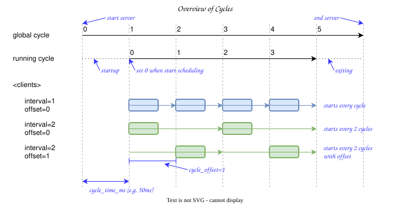

# Process & Server Configuration

The scheduler controls process execution based on periodic cycles and process dependencies.

Each process can be configured with a trigger to determine when it runs.
These triggers can be time-based cycles or the completion of other processes.

## Cycle & Timing Terminology

To understand how the scheduler manages execution, we distinguish between the scheduler's timeline and individual process timing:

### 1. Scheduler Timeline (Cycles)
- **`cycle_time_ms`**: The base time duration of each cycle in milliseconds (e.g., 50ms).
- **`global_cycle`**: The absolute cycle count elapsed since the scheduler started its event loop.
- **`running_cycle`**: The execution cycle count elapsed since the scheduler transitioned to the `Running` state and actively schedules process executions. It starts at `-1` (representing "not started") and increments to `0` at the first running cycle start.

### 2. Process Timing (Start Cycle, Interval & Offset)
- **`start_cycle`**: The initial start cycle number at which the process becomes active in units of running cycles (e.g., `0` for running from the initial cycle, `1` for delaying start by 1 cycle for pipelining).
- **`interval`**: The scheduling interval defining how often the process runs in units of running cycles (e.g., `1` for every cycle, `2` for every other cycle).
- **`offset`**: The phase offset in running cycles applied to the execution timing of the process (`0 <= offset < interval`).

<p align="center">
  
</p>

## Configuration File (TOML)

The scheduler execution rules and server parameters are defined in a TOML configuration file. A sample template is available at `rt-server-rs/config.toml`.

By default, the server reads `config.toml` from the current working directory, but a custom file path can also be specified via command-line options (`--config`).

### Server Configuration (Section: `[server_config]`)

#### Port (Key: `port`)

- **Requirement**: Required | **Type**: Integer (`u16`) | **Range**: `1` – `65535`
- Specifies the UDP port number for the scheduler communication.

#### Base Cycle Time (Key: `cycle_time_ms`)

- **Requirement**: Required | **Type**: Integer (`u32`) | **Unit**: milliseconds
- Specifies the base duration of each cycle in milliseconds (e.g., `50`).
  - The scheduler checks which processes should be run at each cycle.
- **Note:** This is currently implemented using an interval-based trigger.
  - The underlying architecture is designed to support various cycle triggers for future extensibility.

#### Statistics Log Interval (Key: `stats_interval_cycle`)

- **Requirement**: Optional (Default: `0` / disabled) | **Type**: Integer (`u32`) | **Unit**: cycles
- Specifies the interval in running cycles at which the scheduler logs performance statistics for each client.
  - A value of `0` or omitting the parameter disables all statistics logging (including the final shutdown log).
  - If enabled:
    - Logs include metrics like execution time (min, max, average), skip count, late count, and overrun count.
    - Final statistics are also logged when the scheduler shuts down, regardless of the cycle count.

#### Console Log Level (Key: `log_level`)

- **Requirement**: Optional (Default: `"info"`) | **Type**: String
- **Allowed Values**: `"off"`, `"error"`, `"warn"`, `"info"`, `"debug"`, `"trace"` (case-insensitive)
- Specifies the log level for the console (stderr).
  - If omitted, defaults to `"info"`.

#### Log File Directory (Key: `log_file_dir`)

- **Requirement**: Optional (Default: `""` / disabled) | **Type**: String (directory path)
- Specifies the directory path for log files.
  - If omitted or set to an empty string `""`, file logging is disabled.
  - Relative paths are resolved relative to the directory containing the configuration file (in the sample template, this is set to `"./logs"`).

#### File Log Level (Key: `log_file_level`)

- **Requirement**: Optional (Default: `"debug"`) | **Type**: String
- **Allowed Values**: `"off"`, `"error"`, `"warn"`, `"info"`, `"debug"`, `"trace"` (case-insensitive)
- Specifies the log level written to the log file.
  - If omitted, defaults to `"debug"`.
  - Recommended to keep at `"debug"` to ensure detailed `<STAT>` transition events are captured for visualization and post-mortem analysis.

### Client Configuration (Section: `[[client_configs]]`)

Per-client configuration options:

#### Client ID (Key: `client_id`)

- **Requirement**: Required | **Type**: Integer (`u16`) | **Range**: `0` – `999`
- Specifies a unique ID for this process.
  - Used to identify the client process in the scheduler communication and dependency resolution.
  - Each client process in the configuration must have a distinct ID.

#### Initial Start Cycle (Key: `start_cycle`)

- **Requirement**: Required | **Type**: Integer (`u8`) | **Range**: `0` – `255` | **Unit**: cycles
- Specifies the initial start cycle number in running cycles before the process starts execution.
  - `0`: Starts running from the beginning of the scheduler's running state.
  - `1`: Delays initial activation by 1 running cycle. The process remains inactive during cycle `0` and begins its regular schedule starting from cycle `1`.
  - Useful for pipelining (time-axis interleaving) by staggering duplicate task chains across consecutive cycles to maximize execution density.

#### Scheduling Interval (Key: `interval`)

- **Requirement**: Required | **Type**: Integer (`u8`) | **Range**: `1` – `255` | **Unit**: cycles
- Specifies how often to run the process in terms of running cycles (e.g., every cycle, every other cycle).
  - Must not be `0`.
  - `1`: Run every running cycle (e.g., every 50ms if `cycle_time_ms = 50`).
  - `2`: Run every other running cycle (e.g., every 100ms if `cycle_time_ms = 50`).

#### Scheduling Offset (Key: `offset`)

- **Requirement**: Required | **Type**: Integer (`u8`) | **Range**: `0 <= offset < interval` | **Unit**: cycles
- Specifies the phase offset in running cycles for when this client starts running.
  - Useful for alternating the execution of clients to distribute load evenly across cycles.
  - `0`: Start running at the beginning of the specified interval.
  - `1`: Start running one running cycle later than the interval boundary.
  - **Constraint**: The offset value must be strictly less than `interval`.

#### Process Dependencies (Key: `depends`)

- **Requirement**: Required | **Type**: Array of Integers (`u16[]`)
- Specifies a list of Client IDs (`client_id`) that must complete execution before this process can run.
- **Validation Rules**:
  - **Same Start Cycle**: All dependent processes must have the same `start_cycle` (`dep.start_cycle == client.start_cycle`).
  - **Same Interval**: All dependent processes must have the same `interval` (`dep.interval == client.interval`).
  - **Offset Order**: Dependent processes must have an `offset` less than or equal to this process's `offset` (`dep.offset <= client.offset`).
  - **No Self / Duplicate Dependencies**: A process cannot depend on itself, and the same dependency cannot appear multiple times.
  - **No Circular Dependencies**: Circular dependencies within the same interval and offset are strictly prohibited.
- **Execution Timing (AND condition)**:
  - This acts as an AND condition; the process only runs if both its interval/offset condition is met and all dependent processes have completed.
  - **Same Phase (`dep.offset == client.offset`)**: The process starts immediately after the dependent process completes in the same cycle (chain execution).
  - **Earlier Phase (`dep.offset < client.offset`)**: The process waits until its own offset is reached, verifying that the dependent process has already completed.
- **Examples**:
  - `[]`: No dependencies. Runs solely based on `interval` and `offset`.
  - `[10]`: Runs after process `10` completes.
  - `[10, 11]`: Runs after both processes `10` and `11` complete.
- **Lifecycle and Reset**:
  - Dependency completion flags are cleared at the start of each process's execution cycle.
  - This ensures that a process always waits for the execution result of the _latest_ execution cycle of its dependencies, preventing premature startup due to leftover completion flags from previous execution cycles.

#### Display Name (Key: `display_name`)

- **Requirement**: Optional (Default: `""`) | **Type**: String | **Constraint**: Max 20 characters
- Specifies a human-readable name for this process.
  - Used by visualization tools (like Ritsu Vis) to identify processes on charts.
  - Does not affect the actual execution of the process in the scheduler.

#### Expected Execution Duration (Key: `expected_duration_ms`)

- **Requirement**: Optional (Default: `0`) | **Type**: Integer (`u32`) | **Unit**: milliseconds
- Specifies the expected execution time for this process in milliseconds.
  - Used by visualization tools (like Ritsu Vis) to display the "planned" execution time on charts.
  - Does not affect the actual execution of the process in the scheduler.

### Pipeline Execution Pattern (Time-Axis Interleaving)

You can achieve pipelined parallel execution by duplicating a task chain and shifting its start cycle:

#### Configuration Example

```toml
# --- Chain 1 (Starts at cycle 0) ---
[[client_configs]]
client_id = 1
start_cycle = 0
interval = 2
offset = 0
depends = []
display_name = "TaskA_1"

[[client_configs]]
client_id = 2
start_cycle = 0
interval = 2
offset = 1
depends = [1]
display_name = "TaskB_1"

# --- Chain 2 (Starts at cycle 1: Interleaved!) ---
[[client_configs]]
client_id = 11
start_cycle = 1
interval = 2
offset = 0
depends = []
display_name = "TaskA_2"

[[client_configs]]
client_id = 12
start_cycle = 1
interval = 2
offset = 1
depends = [11]
display_name = "TaskB_2"
```

#### Execution Timeline

```
running_cycle:           0       1       2       3       4
Chain 1 (start_cycle=0): [ A1 ]  [ B1 ]  [ A1 ]  [ B1 ]  [ A1 ]
Chain 2 (start_cycle=1):   -     [ A2 ]  [ B2 ]  [ A2 ]  [ B2 ]
```

- **Cycle 0**: Only Chain 1 (`TaskA_1`) runs. Chain 2 remains inactive (`running_cycle < start_cycle`).
- **Cycle 1**: Chain 1 executes `TaskB_1`. Chain 2 evaluates its effective cycle as `process_cycle = running_cycle - start_cycle = 1 - 1 = 0`, triggering `TaskA_2` (`0 % 2 == 0`).
- **Cycle 2**: Chain 1 executes `TaskA_1`. Chain 2 executes `TaskB_2` (`1 % 2 == 1`).

## Command-Line Overrides

Server configurations defined in the TOML file can be temporarily overridden at runtime using command-line arguments.

The following table maps each configuration parameter to its corresponding command-line override option:

| Setting | TOML Key (`[server_config]`) | CLI Override Option | Default Value | Description |
| :--- | :--- | :--- | :--- | :--- |
| **Config File Path** | *(N/A)* | `-c`, `--config <FILE>` | `./config.toml` | Path to the TOML configuration file to load. |
| **Console Log Level** | `log_level` | `--log-level <LEVEL>` | `"info"` | Overrides console log level (`off`, `error`, `warn`, `info`, `debug`, `trace`). |
| **Log File Directory** | `log_file_dir` | `--log-file-dir <DIR>` | `"./logs"` *(in sample)* | Specifies log directory (relative to current working directory) and enables/overrides file logging. |
| **File Log Level** | `log_file_level` | `--log-file-level <LEVEL>` | `"debug"` | Overrides file log level (`off`, `error`, `warn`, `info`, `debug`, `trace`). |
| **Disable File Logging** | *(N/A)* | `--no-log-file` | `false` | Unconditionally disables file logging regardless of TOML settings. |

### Precedence Rules

When both command-line arguments and the configuration file specify a setting, the following precedence order applies:

1. **Command-Line Arguments (CLI)** (Highest priority)
2. **Configuration File (`config.toml`)**
3. **Built-in Application Defaults** (Lowest priority)

Specifically:
- **Console Log Level**: CLI `--log-level` > TOML `log_level` > `"info"`
- **File Log Level**: CLI `--log-file-level` > TOML `log_file_level` > `"debug"`
- **File Logging Activation**:
  - If `--no-log-file` is set, file logging is unconditionally disabled.
  - Otherwise, file logging is enabled if either CLI `--log-file-dir` or TOML `log_file_dir` is non-empty.

### Path Resolution Rules

Relative directory paths for file logging are resolved differently depending on the source to match typical operational expectations:

- **TOML `log_file_dir`**: Resolved relative to the **directory containing the configuration file (`--config`)**. This ensures predictable behavior when distributing the binary and configuration file together as a package.
- **CLI `--log-file-dir`**: Resolved relative to the **current working directory**, adhering to standard command-line tool conventions.
- Absolute paths are used as-is in both cases.

### Console Level Clamping

Due to `flexi_logger` architecture, the console log stream (`duplicate_to_stderr`) cannot be configured with a more verbose level than the active file log stream.

- If file logging is enabled and the resolved console level is more verbose than the file level (e.g., console `debug` and file `info`), the server automatically **clamps** the console level to match the file level (`info`).
- The startup log banner explicitly reports clamped levels:
  ```
  - Log level:      info (clamped from debug)
  - Log file:       logs/rt-server.log
  - Log file level: info
  ```
- If file logging is disabled, the console log level operates independently without clamping.

EOF
