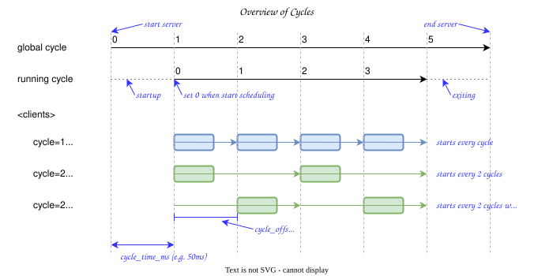

# Process & Server Configuration

The scheduler controls process execution based on periodic cycles and process dependencies.

Each process can be configured with a trigger to determine when it runs.
These triggers can be time-based cycles or the completion of other processes.

## Cycle Terminology

To understand how the scheduler manages execution, we distinguish between the following concepts:

### 1. Time / Tick (Scheduler Clock)
- **`global_cycle`**: The absolute cycle count tracked from the start of the scheduler's event loop (e.g., time-based tick interval).
- **`running_cycle`**: The execution cycle count tracked from when the scheduler transitions to the `Running` state and actually schedules process executions. It starts at `-1` (representing "not started") and increments to `0` at the first running cycle start.

### 2. Scheduling Interval and Offset
- **`cycle` (process's cycle)**: The configuration parameter that defines the scheduling interval of the process (e.g., run every `1` cycle, run every `2` cycles).
- **`cycle_offset`**: The offset in running cycles applied to the start timing of the process.

<p align="center">
  
</p>

## Configuration File (TOML)

The scheduler execution rules and server parameters are defined in a TOML configuration file. A sample template is available at `rt-server-rs/config.toml`.

By default, the server reads `config.toml` from the current working directory, but a custom file path can also be specified via command-line options (`--config`).

### Server Configuration (Section: `[server_config]`)

#### Port (Key: `port`)

- Specify the port number for the scheduler.

#### Base Cycle Time (Key: `cycle_time_ms`)

- Specify cycles using a time-based interval in milliseconds (e.g., 50ms).
  - The scheduler checks which processes should be run at each cycle.

- **NOTE:** This is currently implemented using an interval-based trigger.
  - The underlying architecture is designed to support various cycle triggers for future extensibility.

#### Statistics Log Interval (in cycles) (Key: `stats_interval_cycle`)

- Specifies the interval in running cycles at which the scheduler logs performance statistics for each client.
  - A value of `0` or omitting the parameter disables all statistics logging (including the final shutdown log).
  - If enabled,
    - Logs include metrics like execution time (min, max, average), skip count, late count, and overrun count.
    - Final statistics are also logged when the scheduler shuts down, regardless of the cycle count.

#### Console Log Level (Key: `log_level`)

- Specifies the log level for the console (stderr).
- Allowed values: `"off"`, `"error"`, `"warn"`, `"info"`, `"debug"`, `"trace"` (case-insensitive).
- Defaults to `"info"` if omitted or set to an empty string.

#### Log File Directory (Key: `log_file_dir`)

- Specifies the directory path for log files.
- Relative paths are resolved relative to the directory containing the configuration file.
- If omitted or set to an empty string `""`, file logging is disabled.
- In the sample configuration, this defaults to `"./logs"`.

#### File Log Level (Key: `log_file_level`)

- Specifies the log level written to the log file.
- Allowed values: `"off"`, `"error"`, `"warn"`, `"info"`, `"debug"`, `"trace"` (case-insensitive).
- Defaults to `"debug"` if omitted or set to an empty string.
  - Recommended to keep at `"debug"` to ensure detailed `<STAT>` transition events are captured for visualization and post-mortem analysis.

### Client Configuration (Section: `[[client_configs]]`)

Per client configuration below:

#### Client ID (Key: `client_id`)

- Specifies a unique ID for this process.
  - Each client has a unique ID represented as an integer (`u16`, from `0` to `999`).
  - This ID is used to identify the client in the scheduler.

#### Display Name (Key: `display_name`)

- Specifies a human-readable name for this process.
  - This value is used by visualization tools (like Ritsu Vis) to make it easier to identify processes.
  - It does not affect the actual execution of the process in the scheduler.
  - **Maximum length is 20 characters** to ensure proper display in the UI.
  - If not specified, it defaults to an empty string.

#### Scheduling Interval (in cycles) (Key: `cycle`)

- Specifies how often to run the process in terms of running cycles (e.g., every cycle, every other cycle).
  - `1` means run every running cycle. If the cycle time is 50ms, run every 50ms.
  - `2` means run every other running cycle. If the cycle time is 50ms, run every 100ms.

#### Scheduling Offset (in cycles) (Key: `cycle_offset`)

- Specifies the offset in running cycles for when this client starts running.
  - Useful when you want to alternate the execution of clients to distribute the load evenly.
    - `0`: Start running at the beginning of the specified running cycle.
    - `1`: Start running one running cycle later than the beginning of the specified running cycle.
    - Note: The offset value must be less than `cycle`.

#### Process Dependencies (Key: `depends`)

- Specifies which processes must be completed before this process can run.
- All specified processes must have the same `cycle`.
- This acts as an AND condition, meaning that this process will only run if
  both the cycle condition is met and all specified dependent processes have completed.
  - If the dependent process has the same `cycle` and `cycle_offset`,
    this process starts immediately after the dependent process completes.
  - If the dependent process has a different `cycle_offset`,
    this process starts when the specified `cycle` and `cycle_offset` are reached,
    and only if the dependent process has already completed.
- For example: `client_id=10`, `cycle=2`, `cycle_offset=0`, `depends=[]` and
  - `cycle=2`, `cycle_offset=0`, `depends=[10]`
    - Run every 2nd cycle, starting immediately after process `10` completes.
    - This is because the cycle and cycle offset are the same as process `10`.
  - `cycle=2`, `cycle_offset=1`, `depends=[10]`
    - Run every 2nd cycle, with an offset of 1 cycle, but only if process `10` has already completed.
    - This process will wait until cycle_offset 1 to check if process `10` is complete before starting.
- Processes are identified by their `client_id`.
- Multiple dependencies can be specified in an array; this means all dependent processes must complete.
  - `[]`: No dependencies. Run only based on `cycle` and `cycle_offset`.
  - `[10]`: Run after process `10` completes.
  - `[10, 11]`: Run after both processes `10` and `11` complete.
- **Lifecycle and Reset**:
  - Dependency completion flags are cleared at the start of each process's execution cycle.
  - This ensures that a process always waits for the execution result of the _latest_ execution cycle of its dependencies,
    preventing premature startup due to leftover completion flags from previous execution cycles.

#### Expected Execution Duration (Key: `expected_duration_ms`)

- Specifies the expected execution time for this process in milliseconds.
  - This value is used by visualization tools (like Ritsu Vis) to display the "planned" execution time on a chart.
  - It does not affect the actual execution of the process in the scheduler.
  - Default is `0` if not specified.

## Command-Line Overrides

Server configurations defined in the TOML file can be temporarily overridden at runtime using command-line arguments.

The following table maps each configuration parameter to its corresponding command-line override option:

| Setting | TOML Key (`[server_config]`) | CLI Override Option | Default Value | Description |
| :--- | :--- | :--- | :--- | :--- |
| **Config File Path** | *(N/A)* | `-c`, `--config <FILE>` | `./config.toml` | Path to the TOML configuration file to load. |
| **Console Log Level** | `log_level` | `--log-level <LEVEL>` | `"info"` | Overrides console log level (`off`, `error`, `warn`, `info`, `debug`, `trace`). |
| **Log File Directory** | `log_file_dir` | `--log-file-dir <DIR>` | `"./logs"` *(in sample)* | Specifies log directory (relative to current working directory) and enables/overrides file logging. |
| **File Log Level** | `log_file_level` | `--log-file-level <LEVEL>` | `"debug"` | Overrides file log level (`off`, `error`, `warn`, `info`, `debug`, `trace`). |
| **Disable File Logging** | *(N/A)* | `--no-log-file` | `false` | Unconditionally disables file logging regardless of TOML settings. |

### Precedence Rules

When both command-line arguments and the configuration file specify a setting, the following precedence order applies:

1. **Command-Line Arguments (CLI)** (Highest priority)
2. **Configuration File (`config.toml`)**
3. **Built-in Application Defaults** (Lowest priority)

Specifically:
- **Console Log Level**: CLI `--log-level` > TOML `log_level` > `"info"`
- **File Log Level**: CLI `--log-file-level` > TOML `log_file_level` > `"debug"`
- **File Logging Activation**:
  - If `--no-log-file` is set, file logging is unconditionally disabled.
  - Otherwise, file logging is enabled if either CLI `--log-file-dir` or TOML `log_file_dir` is non-empty.

### Path Resolution Rules

Relative directory paths for file logging are resolved differently depending on the source to match typical operational expectations:

- **TOML `log_file_dir`**: Resolved relative to the **directory containing the configuration file (`--config`)**. This ensures predictable behavior when distributing the binary and configuration file together as a package.
- **CLI `--log-file-dir`**: Resolved relative to the **current working directory**, adhering to standard command-line tool conventions.
- Absolute paths are used as-is in both cases.

### Console Level Clamping

Due to `flexi_logger` architecture, the console log stream (`duplicate_to_stderr`) cannot be configured with a more verbose level than the active file log stream.

- If file logging is enabled and the resolved console level is more verbose than the file level (e.g., console `debug` and file `info`), the server automatically **clamps** the console level to match the file level (`info`).
- The startup log banner explicitly reports clamped levels:
  ```
  - Log level:      info (clamped from debug)
  - Log file:       logs/rt-server.log
  - Log file level: info
  ```
- If file logging is disabled, the console log level operates independently without clamping.

EOF
